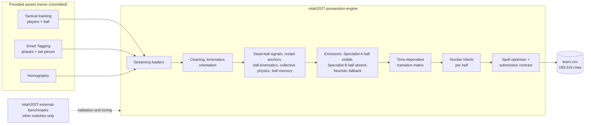

# Opus Operandi

Team entry for **More than a Hack 2027** -- organised by Metrica Sports, FC Barcelona (Barca
Innovation Hub) and Mobile World Capital Barcelona at the Talent Arena.

**Phase 1 task:** for every one of the 199,319 frames of FC Barcelona vs Athletic Club, say who has
the ball -- `H` (home), `A` (away), `D` (dead ball) or `X` (abstain). Ranked on `spellF1`, the F1 of
whole possessions matched by temporal IoU, so what counts is the *number* of possessions and the
precision of their boundaries.

## Our focus: intelligent analysis of the data we were given

The ball is often missing from automatic tracking, and some players drop out of it as well. Instead
of leaning on extra sources, we squeeze the provided assets -- the tracking, the homography and the
Smart Tagging -- with football knowledge:

* possession is **event-like**: it changes at touches, so the decoder only lets it change around a touch;
* when the ball is hidden, **collective movement** (width and advance of the attacking block) still says who
  attacks, and the model learns that on other matches;
* Smart Tagging windows give **exact restart frames** once refined with the tracking;
* the engine is deterministic and reproducible byte for byte.

## Architecture

Optional stages (TV-camera synchronisation, video ball detection, aerial filter, boundary consensus,
semi-Markov decoding) were built, measured on other matches and left off because they did not clear
our adoption rule.

## How we validate, honestly

* The competition forbids hand labels and tuning on the provided game, so **every learned model and every
  tuned parameter comes from other matches** with open data (Bundesliga open data, FIFA World Cup 2022 tracking
  and events, Metrica sample games), labelled algorithmically from provider channels and events.
* Those matches are degraded to look like automatic tracking (hidden ball, identity cuts, player dropouts) and
  evaluated leave-one-match-out with the official scorer.  On such matches the engine roughly triples the
  official-style baseline's spellF1.
* A change is adopted only if it gains at least +0.01 spellF1 with no seed clearly worse; otherwise it stays
  switched off.  Negative results are documented.
* Milestone 9 (in progress): robustness to dropped players and a Smart Tagging prior while the ball is hidden.

## Repositories

| Repository | Purpose | Visibility |
|---|---|---|
| [`mtah2027-possession-engine`](https://github.com/Opus-Operandi-FC-Barcelona/mtah2027-possession-engine) | Phase 1 deliverable: reproducible pipeline, tests, technical document | private until the submission, then public |
| [`mtah2027-external-benchmarks`](https://github.com/Opus-Operandi-FC-Barcelona/mtah2027-external-benchmarks) | Validation and tuning on open data from **other** matches | private until the submission, then public |
| `mtah2027-sandbox-private` | Internal lab | always private |
| `mtah2027-phase2-innovation` | Phase 2: tactical intelligence app and pitch | private |

The match data is licensed for the competition only and is never stored in any of these
repositories.
