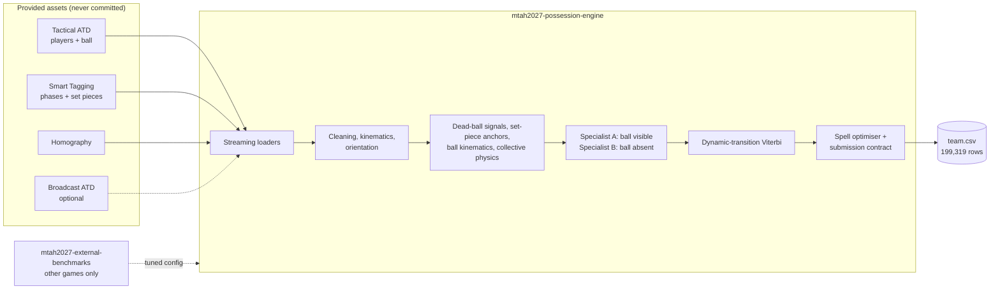

# Opus Operandi

Team entry for **More than a Hack 2027** — organised by Metrica Sports, FC Barcelona (Barça
Innovation Hub) and Mobile World Capital Barcelona at the Talent Arena.

**Phase 1 task:** for every one of the 199,319 frames of FC Barcelona vs Athletic Club, say who has
the ball — `H` (home), `A` (away), `D` (dead ball) or `X` (abstain). Ranked on `spellF1`, the F1 of
whole possessions matched by temporal IoU.

## Architecture

## Repositories

| Repository | Purpose |
|---|---|
| [`mtah2027-possession-engine`](https://github.com/Opus-Operandi-FC-Barcelona/mtah2027-possession-engine) | Phase 1 deliverable: reproducible pipeline, tests, technical report |
| [`mtah2027-external-benchmarks`](https://github.com/Opus-Operandi-FC-Barcelona/mtah2027-external-benchmarks) | Hyper-parameter tuning on open data from **other** matches |
| `mtah2027-sandbox-private` | Internal lab (private) |
| `mtah2027-phase2-innovation` | Phase 2: tactical intelligence app and pitch |

The match data is licensed for the competition only and is never stored in any of these
repositories.
